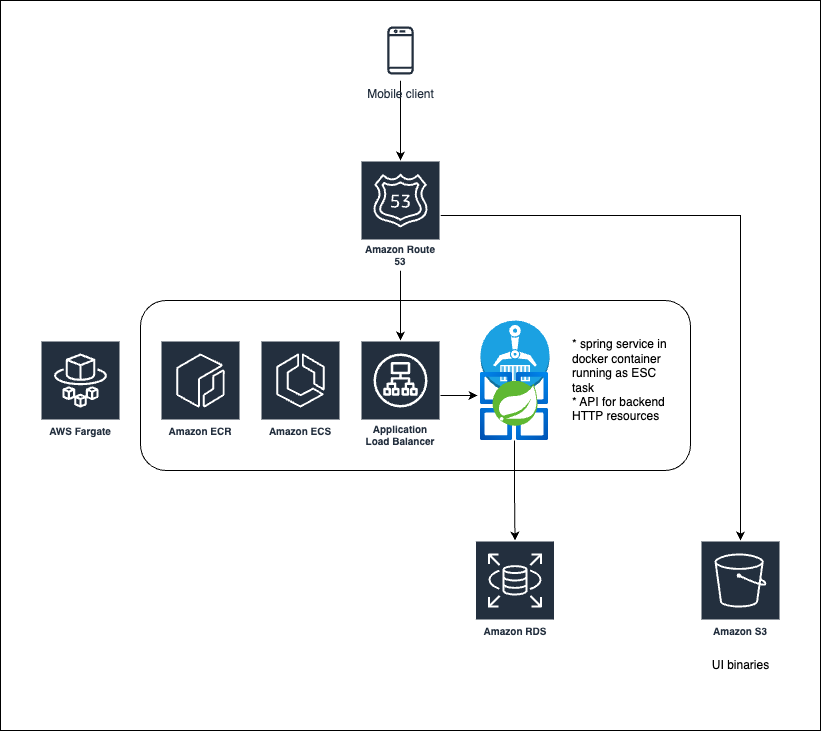

# Infrastructure



## Deploy
```shell
./gradlew :backend:clean :backend:build
cd cdk
npm i
npm run cdk deploy
```
* build the jar and deploy
* after the deployment has finished successfully you can test the running instance from your browser
  see cdk output `CdkStack.TravlrFargateServiceServiceURL`
    * http://cdksta-travl-swubwmi3u5ij-100857690.eu-west-1.elb.amazonaws.com/actuator/health
* if you never used CDK before you ll get an error which can be fixed by
```shell
npm run cdk bootstrap
```

## Destroy
```shell
npm run cdk destroy
```

## Connect to Remote Database (AWS RDS) 
* after running the provided cdk stack and deploying the database and bastion host find in AWS console:
  * BASTION_EC2_INSTANCE_ID (ec2 instances)
  * RDS_HOST (rds secrets)
```shell
BASTION_EC2_INSTANCE_ID="i-085fbbc4259521e6d"
RDS_HOST="postgres-18-1.ct4mwyswge0y.eu-west-1.rds.amazonaws.com"
aws ssm start-session \
  --region eu-west-1 \
  --target $BASTION_EC2_INSTANCE_ID \
  --document-name AWS-StartPortForwardingSessionToRemoteHost \
  --parameters '{"host":["'"$RDS_HOST"'"],"portNumber":["5432"],"localPortNumber":["5433"]}'
```
* then use any database client with host `localhost` and port `5433`
  * for database name, user and password see rds secrets in AWS
